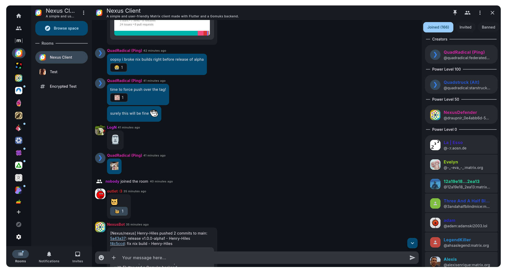
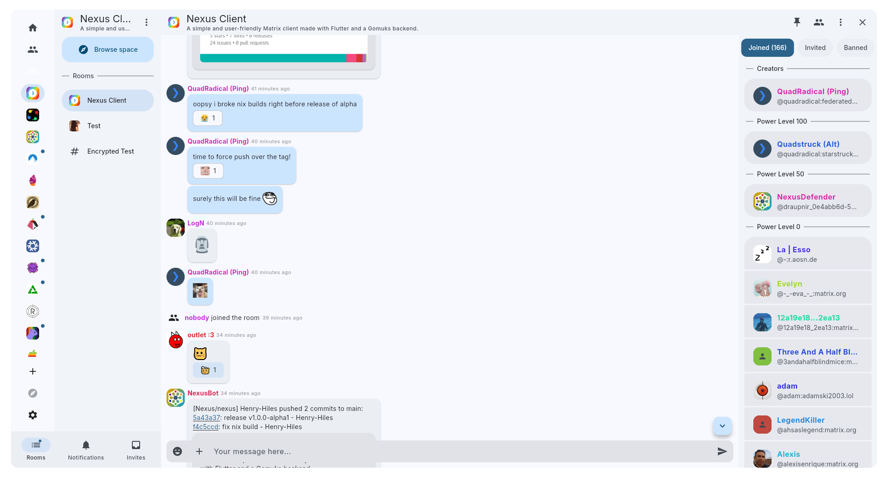

# Nexus Client

## Description

A simple and user-friendly Matrix client made with Flutter and a Gomuks backend.

## Screenshots

|                                                                                  Dark Mode                                                                                   |                                    Light Mode                                    |
| :--------------------------------------------------------------------------------------------------------------------------------------------------------------------------: | :------------------------------------------------------------------------------: |
|  |  |

## Try it out

If you want to try out Nexus, download the [latest release](https://git.federated.nexus/Nexus/nexus/releases/latest).

### Nightly Builds

For the newest changes, grab one of the following nightly artifacts, built by CI from the latest commit on `main`.

- [Android APK](https://nightly.link/Henry-Hiles/nexus/workflows/android/main/APK.zip)
- [Unsigned iOS IPA](https://nightly.link/Henry-Hiles/nexus/workflows/ios/main/Nexus.ipa.zip)
- [Unsigned MacOS DMG](https://nightly.link/Henry-Hiles/nexus/workflows/macos/main/nexus.dmg.zip)
- [Windows EXE](https://nightly.link/Henry-Hiles/nexus/workflows/windows/main/windows-installer.zip)

Or, use one of the below methods:

### Nightly Flatpak Repo

Make sure Flatpak is set up on your system, then run:

```bash
flatpak install --user https://nexus.federated.nexus/flatpak/nexus.flatpakref
```

This adds the Nexus remote and installs the app for your user only, so no root access is needed (x86_64 and aarch64 are supported). To install system-wide instead, use `--system` in place of `--user`. Updates arrive through `flatpak update` or your software center.

### NixOS Module

Add Nexus as a flake input, following `nixpkgs` for less fetches:

```nix
nexus = {
  url = "git+https://git.federated.nexus/Nexus/nexus";
  inputs.nixpkgs.follows = "nixpkgs";
};
```

This tracks the latest commit on `main`. To stay on a release instead, pin the input to its tag:

```nix
url = "git+https://git.federated.nexus/Nexus/nexus?ref=refs/tags/v1.0.0";
```

Then import the module and enable it in your NixOS configuration:

```nix
{ inputs, ... }:
{
  imports = [ inputs.nexus.nixosModules.default ];

  programs.nexus = {
    enable = true;
    enableNotifications = true; # optional: push notifications via UnifiedPush
  };
}
```

This installs Nexus system-wide. With `enableNotifications`, it also installs KUnifiedPush and registers its systemd and D-Bus services so notifications work. The `package` option lets you override the package if you need to.

## Build it yourself

### Prerequisites

#### Linux

- On NixOS: Either use direnv and `direnv allow`, or `nix develop`
- On other distros: Install Flutter, Go, Git, Libclang, Libass, MPV, and Glibc. Do not use any Snap packages, they cause various compilation issues.

#### Windows

You will need:

- Flutter
- Git
- Libass
- MPV
- Go
- Visual Studio 2022 (Desktop development with C++)
- [MSYS2/MinGW-w64 GCC](https://www.msys2.org/) (for CGO)
- [LLVM/Clang + libclang](https://clang.llvm.org/get_started.html) (for `ffigen`)

On Windows, make sure these are available in your shell `PATH`:

- `C:\msys64\ucrt64\bin` (or your MinGW bin path containing `x86_64-w64-mingw32-gcc.exe`)
- `C:\Program Files\LLVM\bin` (contains `clang.exe` and `libclang.dll`)

For `dart scripts/generate.dart`, you may also need:

```powershell
$env:CPATH = "C:\msys64\ucrt64\include"
```

#### MacOS

Similar prerequisites apply (Flutter, Git, Go, C toolchain, LLVM/libclang), but exact setup has not been fully documented yet.

### Clone repo

First, clone and open the repo:

```sh
git clone --recurse-submodules https://git.federated.nexus/Nexus/nexus
cd nexus
```

### Set up Flutter

Get dependencies:

```sh
flutter pub get
```

Generate Gomuks bindings:

```sh
dart scripts/generate.dart
```

> [!NOTE]
> If you are having issues with `stddef.h` not being found, try setting CPATH manually:
>
> ```sh
> export CPATH="$(clang -v 2>&1 | grep "Selected GCC installation" | rev | cut -d' ' -f1 | rev)/include"
> ```

Build generated files, and watch for new changes:

```sh
flutter pub run build_runner watch
```

Run the app:

```sh
flutter run
```

Development instructions can be found in [DEVELOPMENT.md](./DEVELOPMENT.md).

## Community

Join the [Nexus Client Matrix room](https://matrix.to/#/#nexus:federated.nexus) for questions or help with developing or using Nexus Client.

## Credits

Thank you Hylke Bons (https://planetpeanut.studio) for making the amazing icon for Nexus!
Thank you Tulir Asokan for making [Gomuks](https://github.com/gomuks/gomuks), and helping us integrate it into Nexus!
